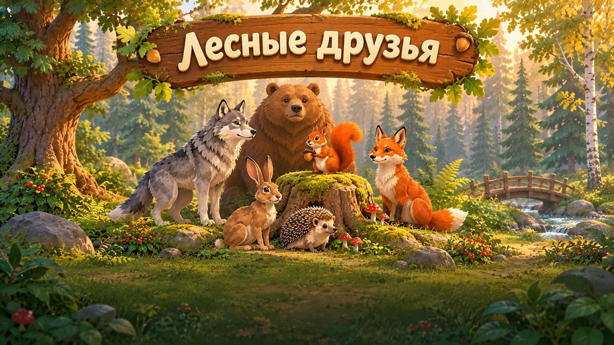
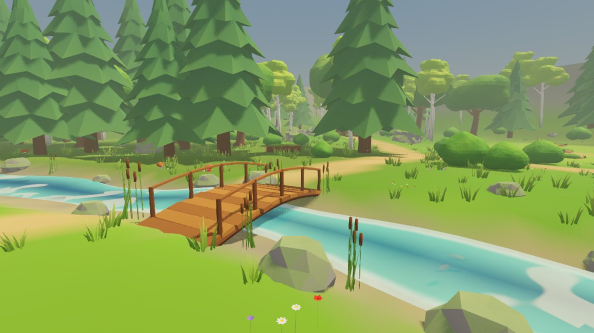
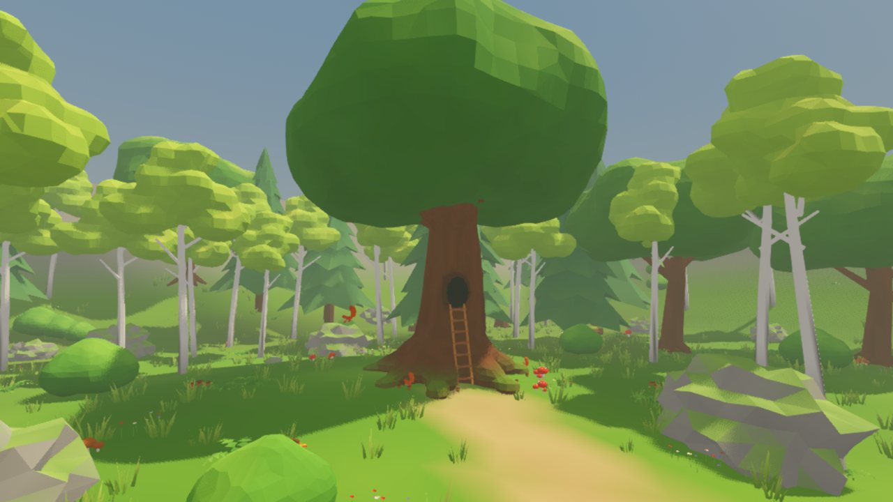
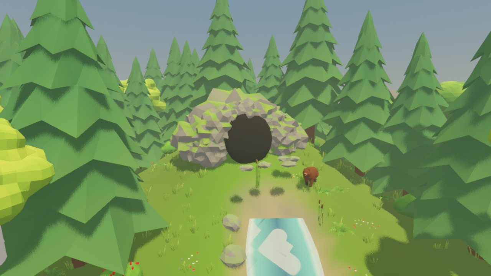
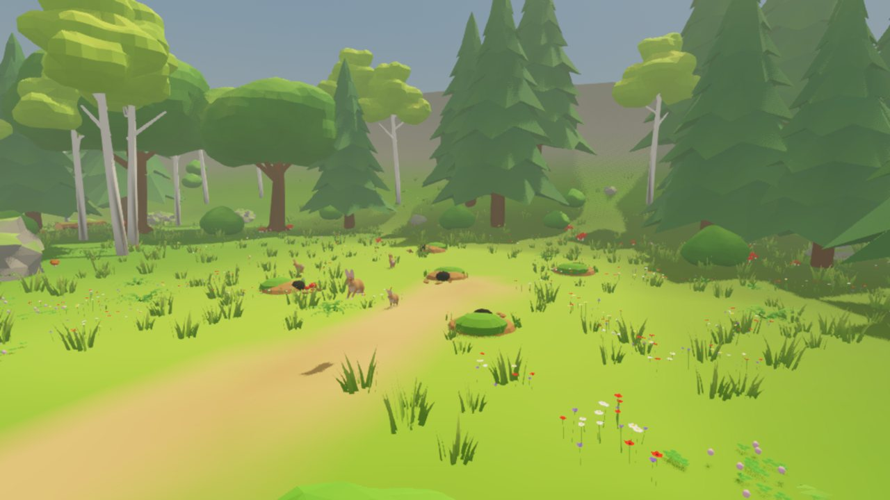
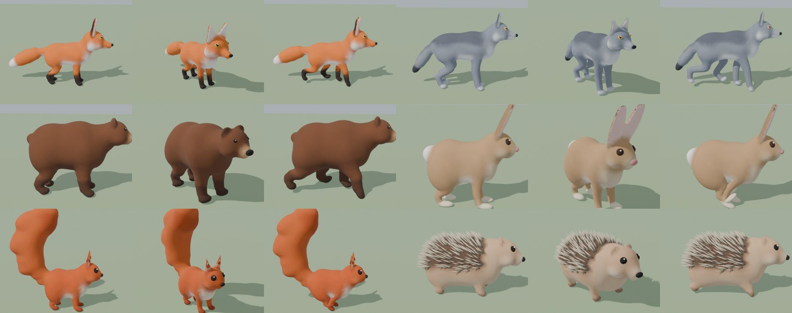
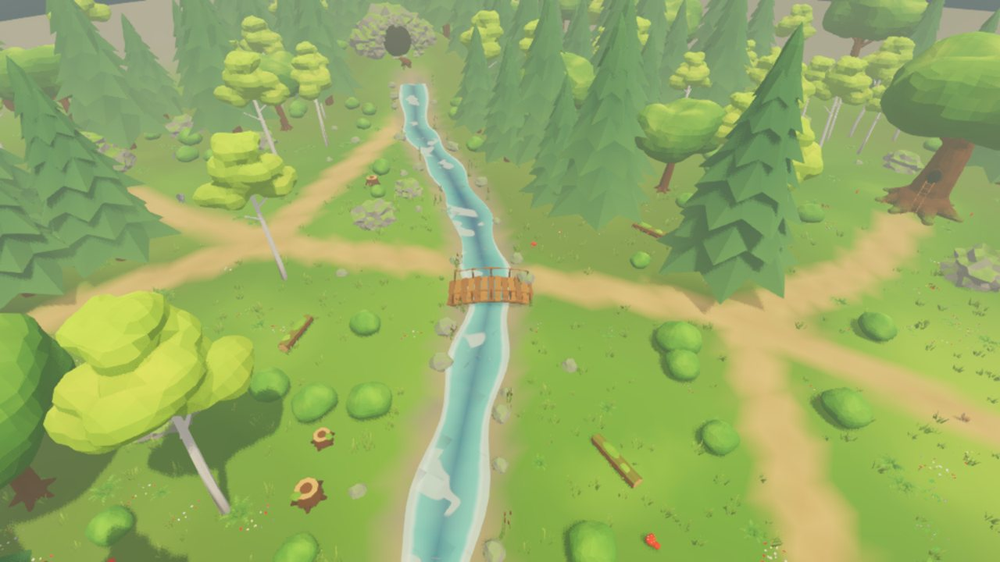

<p align="center">
  
</p>

<h1 align="center">Лесные друзья · Forest Friends</h1>

<p align="center">
  <b>Уютная 3D-игра про жизнь лесных зверей.</b> Выберите волка, лису, зайца, медведя, белку или ежа и проживите
  его день: найдите еду, спрячьтесь от хищника или догоните добычу, к ночи вернитесь домой и выспитесь.
  Остальные звери живут в лесу сами.
</p>

<p align="center">
  <a href="https://severance.lol/5/"><b>▶ Играть в браузере</b></a> ·
  <a href="https://github.com/msveshnikov/forest/releases/latest/download/ForestFriends.exe">Windows .exe</a> ·
  <a href="https://github.com/msveshnikov/forest/releases/latest/download/ForestFriends.apk">Android .apk</a> ·
  <a href="https://github.com/msveshnikov/forest/releases/latest">Все релизы</a>
</p>

<p align="center">
  <a href="https://github.com/msveshnikov/forest/releases/latest"></a>
  
  
  
</p>

| | |
|---|---|
|  |  |
|  |  |

<p align="center"></p>

### Особенности
- **Шесть зверей, у каждого свой характер.** Хищники охотятся, зайцы и белки убегают, волк и ёж ведут ночную
  жизнь, медведь ловит рыбу в ручье.
- **Живой лес 100×100 м** по нарисованной карте: пещера медведя на холме, ручей с мостиком, логово волка
  в мшистых скалах, нора лисы под корнями, дуб белки с дуплом и лесенкой, поляна зайцев, гнездо ежа у пруда.
- **Смена дня и ночи, голод и усталость.** Еда отрастает: ягоды, грибы, жёлуди, клевер, жуки, рыба.
- **Ни одного ассета, сделанного вручную.** Концепт-арт нарисован в ChatGPT, а все модели, скелеты,
  анимации, раскраска и карта созданы Python-скриптами в Blender. Любой файл пересобирается одной командой.
- **ПК, телефон и браузер.** Управление с клавиатуры и мыши или сенсорное, адаптивное качество
  для слабых видеокарт.



## Управление
| Клавиша | Действие |
|---|---|
| WASD / стрелки | идти |
| Shift | бежать |
| Пробел | прыжок |
| Мышь / колесо | камера / приближение |
| E | съесть еду рядом / лечь спать дома / проснуться |
| F или ЛКМ | поймать добычу (только хищники) |
| Esc | пауза, выход в меню |

**Сенсорное управление** включается само на телефонах (APK и мобильный браузер), а на других устройствах после первого касания экрана.
Левый палец — плавающий стик (вытянуть за внешнее кольцо — бег), правый палец — камера, два пальца — приближение.
Кнопки: «Действие» (подсвечивается и подписывается «Съесть», «Спать» или «Встать», когда есть что сделать), «Прыжок»,
«Поймать» (только у хищников), «II» — пауза. Код: `scripts/touch_controls.gd`. На ПК можно проверить с аргументом `-- --touch`.

## Сборка и выкладка
Пресеты `Web`, `Android` и `Windows Desktop` лежат в `export_presets.cfg` (exe одним файлом, игра встроена). На вебе и Android рендерер Compatibility, текстуры S3TC+ETC2,
APK подписан debug-ключом, arm64, альбомная ориентация.
```
godot --headless --path . --export-release "Web" build/web/index.html
godot --headless --path . --export-debug "Android" build/android/ForestFriends.apk
godot --headless --path . --export-release "Windows Desktop" build/windows/ForestFriends.exe
scp build/web/* build/android/ForestFriends.apk ubuntu@severance.lol:/var/www/severance/5/
```

## Как устроено
- 6 зверей со скелетом из 20–23 костей и анимациями: idle, walk, run, jump, eat, sleep, а у хищников ещё attack.
  Это 5–8 тыс. треугольников на зверя, масштаб реальный: ёж ≈ 0.22 м, медведь ≈ 1.1 м в высоту.
- Лес 100×100 м по карте из концепт-арта:
  - пещера медведя на холме (СЗ), из которой бежит ручей с мостиком;
  - логово волка в мшистых скалах (З);
  - нора лисы под корнями (ЮЗ);
  - дупло белки в старом дубе с лесенкой (СВ);
  - поляна зайцев с норками (В);
  - гнездо ежа из листьев у пруда (ЮВ).
- Еда, которая отрастает: ягоды, грибы, жёлуди, клевер, жуки в брёвнах, рыба в ручье и пруду.
- ИИ на машине состояний: блуждание → поиск еды → еда → домой → сон, плюс бегство и погоня.
  Навигация через NavigationRegion3D и NavigationAgent3D, навмеш запекается при старте.
  Ночные звери (волк, ёж) днём спят в домах.
- Смена дня и ночи (сутки = 10 минут), голод и усталость. Сон дома ускоряет время.
- Рендер Mobile (на вебе и Android Compatibility) и адаптивный масштаб 3D-рендера ради 60 FPS на слабых
  видеокартах. Почти всё окрашено цветами вершин, так что у модели один-два материала и мало вызовов отрисовки.

## Структура
```
assets/models/      .glb из Blender (звери, деревья, камни, дома, рельеф, вода…)
assets/data/        ресурсы AnimalStats (*_stats.tres), layout.json — раскладка леса
assets/icons/       иконки Android (адаптивные слои 432×432 и основная 192×192), исходники SVG рядом; общая иконка — icon.svg
scenes/animals/     animal_base.tscn + 6 наследованных сцен, player_controller.tscn, ai_controller.tscn
scenes/environment/ обёртки моделей, источники еды (food_*.tscn), дома (home_*.tscn)
scenes/world/       forest.tscn — главная локация, camera_rig.tscn
scenes/ui/          main_menu.tscn, animal_select.tscn, hud.tscn, preview_stage.tscn
scenes/main.tscn    точка входа
scripts/            GDScript
tools/blender/      скрипты генерации моделей, звери, окружение, карта (Blender без интерфейса, см. ниже)
tools/*.py          генераторы сцен видов и forest.tscn из layout.json
docs/images/        картинки для README
concept/            референс-арт из ChatGPT (день, ночь, лист зверей, дома, карта, титульный экран); промпты и стайл-блок —
                    в «Forest Friends — concept art and tasks.md». Godot его не импортирует (.gdignore)
```

## Как пересобрать ассеты
Всё делается скриптами в Blender без интерфейса (Blender 5.2: `C:\Program Files\Blender Foundation\Blender 5.2\blender.exe`;
Godot 4.7.2: `%USERPROFILE%\OneDrive\Рабочий стол\Godot_v4.7.2-stable_win64.exe`):
```
blender -b --factory-startup -P tools/blender/animals.py -- fox wolf bear hare squirrel hedgehog [--render DIR]
blender -b --factory-startup -P tools/blender/environment.py -- [имена…] [--render DIR]
blender -b --factory-startup -P tools/blender/terrain.py
python tools/gen_species.py && python tools/gen_forest.py && python tools/set_import_script.py
godot --headless --path . --import
```
- **Звери** (`animals.py`): тело лепится из метаболов (сглаженные эллипсоиды) по параметрам вида, затем
  упрощается до 5–8 тыс. треугольников. Окраска (брюшко, «носочки», кончик хвоста, уши, седло волка)
  считается по частям тела и пишется в цвета вершин. Глаза, нос, кисточки белки и иглы ежа ставятся на
  поверхность рейкастами. Скелет из 20–23 костей (позвоночник, шея, уши, хвост из 3 костей, ноги по 3 кости),
  веса плавные и тоже берутся из частей тела. Анимации те же: idle, walk, run, eat, sleep, jump, attack.
  Опция `--render DIR` сохраняет превью (сбоку, 3/4, спереди, ходьба, бег, сон, еда).
- **Окружение** (`environment.py` + `paint.py`): кроны деревьев и кусты тоже из метаболов. «Покраска»
  (`paint.py`) переводит цвета материалов в цвета вершин с мягким затенением снизу, светлыми верхушками,
  шумом и пятнами мха, а все материалы модели сводит в один или два. Так меньше вызовов отрисовки.
- **Карта** (`terrain.py`): сначала раскладка (`assets/data/layout.json`), потом рельеф. Земля
  раскрашивается по положению: пятна травы, тень под деревьями, песчаные тропы с мягким краем,
  дно ручья, мох на склонах, светлая поляна зайцев. В цвете вершин воды записана глубина (0 у берега,
  1 в середине), её читает шейдер `assets/materials/water.gdshader`.
- Цвета вершин в Godot включает скрипт импорта `scripts/import/vertex_color_import.gd`. Его прописывает
  во все `.glb.import` `tools/set_import_script.py`, запускать после появления новых моделей.

## Отладка
Если в корне проекта лежит `debug_shots.json`, автозагрузка `DebugShots` делает скриншоты в `screenshots/`,
может нажимать действия, ускорять время, ставить час суток, выбирать вид и вызывать методы сцены.
Пример: `{"times":[5], "quit":6, "hour":22, "species":"wolf", "press":{"move_forward":[1,5]}}`.
Тест еды и сна: `{"quit":16, "call":["debug_test_needs"]}` при запуске `forest.tscn`.
Тест сенсорного управления: `{"quit":8, "call":["debug_test_touch"]}` при запуске `forest.tscn`.
Ещё опции: `"views": [[t, x, y, z, lx, ly, lz], …]` ставит свободную камеру в (x, y, z) и смотрит на (lx, ly, lz)
начиная с секунды t, `"hide": ["Foliage", "Trees", …]` прячет узлы сцены, `"novsync": true` отключает vsync
для честного замера FPS. В лог пишутся FPS, число примитивов, вызовов отрисовки и время process/physics.
Файл в .gitignore.
